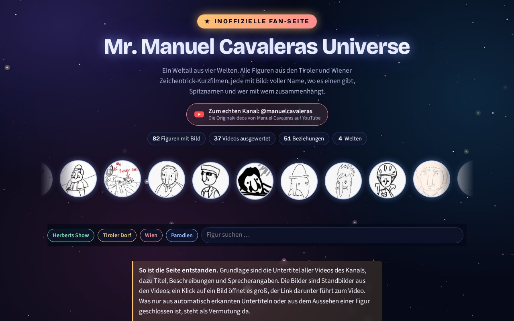
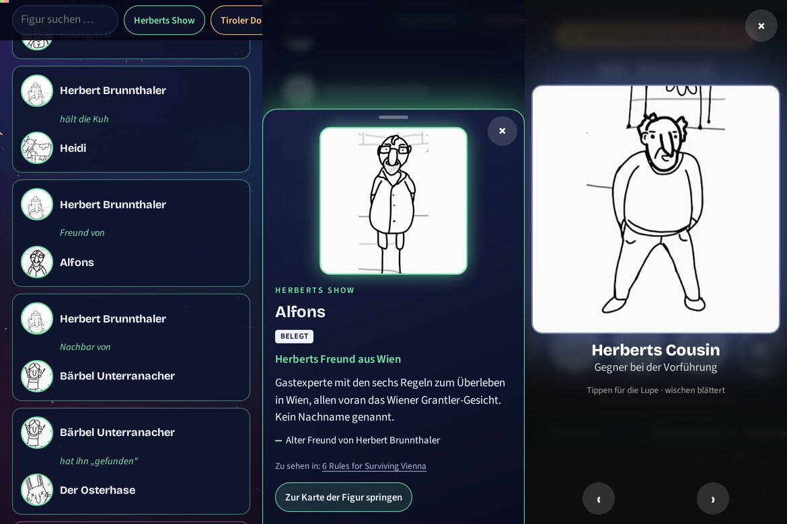

# Mr. Manuel Cavaleras Universe

Inoffizielle Fan-Seite zu den Zeichentrick-Kurzfilmen des YouTube-Kanals [Mr. Manuel Cavaleras](https://www.youtube.com/@manuelcavaleras): alle Figuren mit Bild, vollem Namen, Spitznamen und ihren Beziehungen.

**Zur Seite:** https://tunefish92.github.io/Mr.-Manuel-Cavaleras-Universe/

## Was die Seite zeigt

- **82 Figuren**, jede mit einem Standbild aus dem Video, ihrer Rolle, Spitznamen, einer kurzen Beschreibung und Links zu den Videos, in denen sie vorkommt
- **Vier Welten:** Herberts Show, das Tiroler Dorf, Wien, Parodien und Sonstiges
- **Beziehungskarte** der 26 wichtigsten Figuren
- **Tabelle aller 51 Beziehungen**, jede als „belegt“ oder „vermutet“ markiert
- **Nur erwähnt oder gehört:** Figuren, die nie im Bild sind, etwa Margot, der Bub vom Plona oder Dr. Feldgruber
- **37 ausgewertete Videos** mit Links zum Original

## So bedienst du sie

- **Profil öffnen:** Eine Figur in der Beziehungskarte oder eines der runden Bilder ganz oben anklicken. Das Profil zeigt Bild und alle Angaben.
- **Bild groß ansehen:** Das Bild auf einer Karte oder im Profil anklicken. Ein Klick ins große Bild schaltet die Lupe ein, die Pfeiltasten blättern zur nächsten Figur.
- **Suchen:** Im Suchfeld nach Name, Rolle oder Stichwort tippen, die Karten werden sofort gefiltert.
- **Name anzeigen:** Mit der Maus über ein rundes Bild fahren.
- **Springen:** Die Knöpfe in der Leiste führen zu den vier Welten.

## Am Handy

Die Seite passt sich an schmale Bildschirme an:

- Die Beziehungskarte wird zu einer Liste, in der sich jede Figur antippen lässt.
- Das Profil kommt als Blatt von unten und lässt sich nach unten wegwischen.
- In der Großansicht blättert seitliches Wischen, Tippen schaltet die Lupe ein.
- Die Leiste mit Suche und Welten bleibt einzeilig und lässt sich seitlich wischen.

Wer im System „Bewegung reduzieren“ eingestellt hat, bekommt die Seite ohne Animationen.

## Woher die Angaben stammen

Stand 20. November 2026. Grundlage sind die Untertitel aller Videos des Kanals, dazu Titel, Beschreibungen und Sprecherangaben.

- **Belegt** heißt: im Video gesagt oder gezeigt, oder in der Beschreibung genannt.
- **Vermutet** heißt: aus dem Aussehen einer Figur, aus Merch-Namen oder aus automatisch erkannten Untertiteln geschlossen.

Zu jedem Standbild nennt [figuren/README.md](figuren/README.md) das Video und die Stelle. Nicht aufgenommen sind die Musikvideos, die Realfilme von 2005 bis 2009 und „Wienliebe“, das aus fremden Fernsehausschnitten besteht.

Fehler gefunden oder eine Figur fehlt? Bitte ein [Issue](https://github.com/Tunefish92/Mr.-Manuel-Cavaleras-Universe/issues) anlegen.

## Hinweis

Dies ist eine Fan-Seite und kein Angebot von Manuel Cavaleras; sie ist nicht mit ihm verbunden. Alle Figuren, Bilder und Texte gehören ihrem Schöpfer. Die Originalvideos gibt es auf [seinem Kanal](https://www.youtube.com/@manuelcavaleras).

## Von wem

Gemacht von [Tunefish](https://github.com/Tunefish92), einem Fan der Videos, mit KI-Unterstützung (Claude Code).

## Technik

Eine statische Seite ohne Build-Schritt, veröffentlicht über GitHub Pages aus dem Branch `main`.

| Pfad | Inhalt |
|---|---|
| `index.html` | Die ganze Seite: Aufbau, Gestaltung, Daten und Skript |
| `figuren/` | Ein Standbild pro Figur und die Liste mit Video und Stelle |
| `figuren/thumb/` | Verkleinerte Fassungen für die runden Bilder |
| `tools/` | Skripte, mit denen Standbilder und Vorschaubilder erzeugt wurden |

Zum Ansehen genügt es, `index.html` im Browser zu öffnen. Nach einem neuen Standbild erzeugt `tools/thumbs.sh` das passende Vorschaubild.
